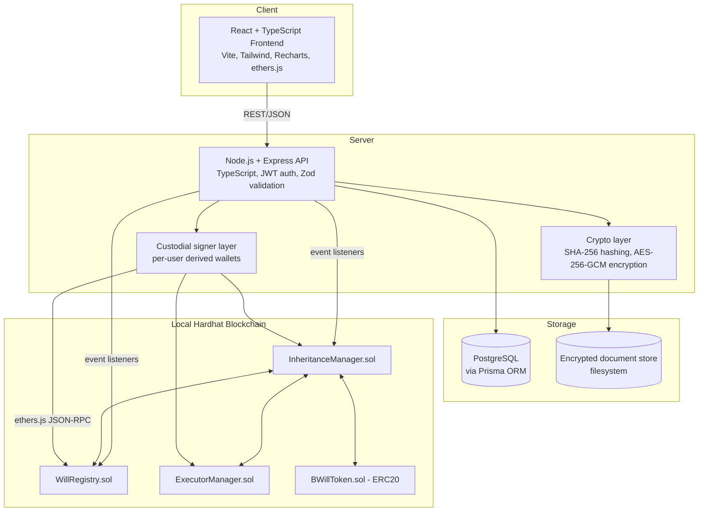
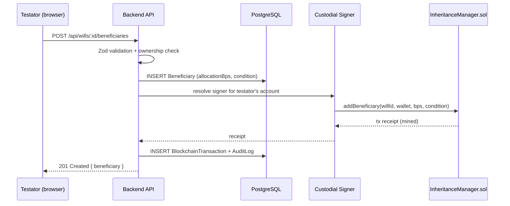

# Architecture

BlockWill is a monorepo with four workspaces:

```
blockwill/
├── contracts/   Solidity smart contracts + Hardhat (BWillToken, WillRegistry, ExecutorManager, InheritanceManager)
├── backend/     Node.js + Express + TypeScript API, Prisma ORM, blockchain integration
├── frontend/    React + TypeScript + Vite + Tailwind CSS SPA
├── shared/abi/  Generated ABIs + deployment.json, written by contracts/scripts/deploy.ts, read by backend
└── docs/        This directory
```

## Overall architecture



## Why this shape

- **Frontend never talks to the chain directly for write operations.** All state-changing actions go through the backend API, which resolves the correct signer for the authenticated user and submits the transaction. This keeps private keys off the client entirely and lets one backend process serve every role in the demo without six simultaneous MetaMask sessions. See `docs/security.md` for the full custodial-signer trade-off discussion.
- **PostgreSQL is the query layer, the chain is the integrity layer.** Every write that matters for trust (will hash, status transitions, distribution events) is also sent to the chain; PostgreSQL caches/denormalizes that state plus everything that must never be public (personal data, encrypted document paths, relationship metadata) for fast, expressive querying.
- **The encrypted document store is separate from both.** Documents are encrypted (AES-256-GCM) before they ever touch disk; only the hash goes anywhere else.

## On-chain vs. off-chain data

| On-chain (WillRegistry / InheritanceManager / ExecutorManager) | Off-chain (PostgreSQL + encrypted filesystem) |
|---|---|
| Will ID (bytes32), document SHA-256 hash | Encrypted PDF/document bytes |
| Testator/beneficiary/executor/witness wallet addresses | Names, emails, relationships, identity references |
| Beneficiary allocation (basis points) | Asset descriptions, estimated values, notes |
| Status enum + timestamps | UI-facing denormalized will/beneficiary/asset records |
| Witness signature confirmations | Notification history, email simulation log |
| Death-verification certificate hash | Certificate file, verifier notes |
| Dispute open/resolve events | Dispute free-text description |
| All events (`WillCreated`, `WitnessSigned`, `AssetDistributed`, …) | Full audit log (mirrors + enriches on-chain events) |

This split exists because blockchain storage is expensive, public, and immutable by design — none of which is appropriate for a PDF full of personal and financial details. See `docs/security.md` and `docs/blockchain.md` for the reasoning in more depth.

## Request lifecycle example — adding a beneficiary


