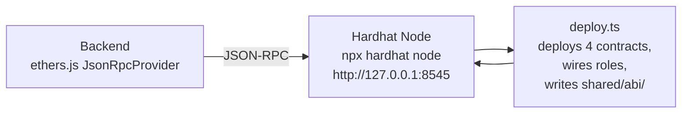
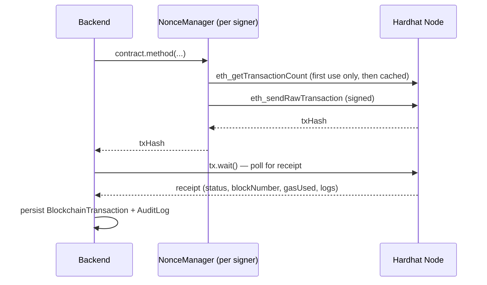

# Blockchain Layer

BlockWill runs entirely on a **local Hardhat network** (chain ID `31337`) for development and demonstration. No paid API, testnet faucet, or real cryptocurrency is required.

## Why blockchain here at all?

Three properties a will-and-inheritance system needs that a plain database can't provide on its own:

1. **Tamper-evidence.** Once `WillRegistry.finalizeWill()` is called, the document hash and status history are recorded in transactions that cannot be silently edited — not even by BlockWill's own administrators (see `docs/security.md`, "What the admin cannot do").
2. **Verifiable execution.** `InheritanceManager.executeInheritance()` is a public, auditable function. Anyone with the will ID can independently verify on-chain that the correct beneficiaries received the correct proportional amounts, without trusting BlockWill's backend.
3. **Non-repudiation.** Witness signatures and executor approvals are transactions signed by that party's own key (in this demo, a per-account custodial key — see below) — a specific, attributable action, not just a database flag someone could edit.

## What's actually stored on-chain

See the table in `docs/architecture.md`. In short: hashes, addresses, statuses, timestamps, and events — never the will's contents.

## Local network topology

Hardhat's default local network pre-funds the first 20 accounts (derived from the well-known test mnemonic `test test test … junk`) with 10,000 test ETH each. BlockWill's 9 demo personas use accounts `0`–`8` from that same mnemonic; every other registered user gets a deterministic wallet from a much larger derivation range and is funded on demand by a small internal faucet (`backend/src/blockchain/faucet.ts`). None of this ever touches a real network — the mnemonic is Hardhat's own publicly documented default, not a secret.

## Custodial signer model (and why)

A real end-user Web3 app has each party sign with their own wallet (MetaMask, hardware wallet, etc). Demonstrating BlockWill's full lifecycle needs **six roles acting in sequence** (testator, two witnesses, authority, executor, beneficiaries) — impractical to demo live with six separate browser wallet sessions.

BlockWill's backend instead derives one Ethereum wallet per user account (`backend/src/blockchain/signers.ts`) and signs transactions on that user's behalf when they call the API. Every transaction is still a real, independently verifiable transaction signed by that specific account's private key — the simplification is in *where the key lives* (server-managed, never exposed to the client or committed to source), not in whether the action is real. A connected MetaMask wallet is also available in the UI (`Settings` page) for inspecting balances/network directly, and is the natural next integration point for signing directly in a non-demo deployment.

This trade-off, its risks, and how it differs from a production wallet-custody system are discussed in full in `docs/security.md`.

## Transaction lifecycle

Each signer is wrapped in ethers' `NonceManager` and cached per derivation index, so a burst of sequential transactions from the same account (e.g. the demo control panel's "Create Demo Will" step, which fires several transactions from the testator's address back-to-back) doesn't race on nonce lookups.

## What happens if the blockchain goes offline?

- `GET /api/blockchain/status` reports `reachable: false` and the UI surfaces this on the Blockchain Explorer and DLT Network pages.
- Any API call requiring a transaction fails cleanly with a 500 and a clear (non-stack-trace) error message; the database remains internally consistent since the DB write and the chain call are attempted in a fixed order per operation, and route handlers do not swallow chain errors.
- No previously-recorded on-chain state is lost — the chain is either producing blocks or it isn't; there is no partial/corrupted state possible for BlockWill's own contracts.
- Restarting the node with the same deployment (or redeploying) restores service; a fresh Hardhat node has a clean, empty chain, which is why `shared/abi/deployment.json` is regenerated on every `npm run deploy`.
