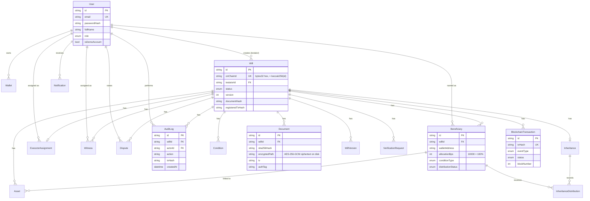

# Database

PostgreSQL, accessed via Prisma ORM. Schema: `backend/prisma/schema.prisma`.

## Design principles

- **PostgreSQL never holds a private key.** All signing key material is derived at runtime from an environment-configured mnemonic (see `docs/security.md`) — nothing sensitive-key-related is persisted.
- **PostgreSQL is the only place personal data lives.** Names, emails, relationships, identity references, encrypted-document file paths, and free-text notes are all off-chain by design.
- **Every table that represents a critical fact has a corresponding on-chain transaction hash column** (`registeredTxHash`, `signedTxHash`, `decisionTxHash`, `distributedTxHash`, etc.) so the UI can always link database state back to its on-chain proof.
- **`AuditLog` and `BlockchainTransaction` are append-only.** No route ever issues an `UPDATE` or `DELETE` against either table.

## Entity-relationship diagram

## Full model list

`User`, `Wallet`, `Will`, `WillVersion`, `Beneficiary`, `Asset`, `ExecutorAssignment`, `Witness`, `Condition`, `Document`, `VerificationRequest`, `Inheritance`, `InheritanceDistribution`, `Dispute`, `AuditLog`, `Notification`, `EmailLog`, `BlockchainTransaction`, `DeployedContract`.

## Versioning

Updating a will's document while still in `DRAFT` increments `Will.version` and calls `WillRegistry.updateDocumentHash` on-chain (recording the new hash and version number in a `WillDocumentUpdated` event). At `finalizeWill` time, a `WillVersion` snapshot row is written containing the beneficiary/asset/executor state as of that version — prior versions are preserved, never overwritten.

## Indexing

Foreign keys and frequently-filtered columns (`Will.status`, `Will.testatorId`, `AuditLog.willId`/`actorId`/`createdAt`, `BlockchainTransaction.txHash`/`eventType`, `Beneficiary.walletAddress`) are indexed in the Prisma schema to keep dashboard and explorer queries fast without needing a caching layer at this scale.
