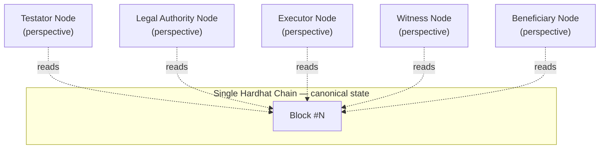

# Distributed Ledger Technology (DLT)

## What DLT means here

Distributed Ledger Technology's core promise is that **every participant in a transaction can independently verify the same history of events**, without needing to trust a single central party to tell them the truth. A blockchain (like the Hardhat chain BlockWill runs on) is one specific implementation of a distributed ledger — a chain of cryptographically linked blocks, replicated and validated by every node in the network.

## What BlockWill demonstrates, honestly

BlockWill's local development environment runs **one Hardhat node**, not a multi-node peer-to-peer network — that would be impractical to spin up for a local academic demo. The `/dlt-network` page (`GET /api/blockchain/dlt-network`) is a **conceptual visualization**: it labels five perspectives on that single chain — Testator Node, Legal Authority Node, Executor Node, Witness Node, Beneficiary Node — and shows that all five observe the exact same block number and block hash at all times.

This is not a trick or a simplification that hides something real — it is precisely the property DLT is meant to guarantee: **shared, tamper-evident, independently-verifiable state**. The UI is explicit about this (see the "ACADEMIC SIMULATION" / "DLT Network Visualization" labeling in `frontend/src/pages/DltNetworkPage.tsx`) — it does not claim these are independent physical nodes.

## DLT network (conceptual)

## How this scales to a real deployment

A production BlockWill deployment would run against a real multi-node network — either a public chain (Ethereum mainnet or an L2) where thousands of independent validators already provide this guarantee, or a permissioned consortium chain operated jointly by, for example, a bar association, a notary registry, and participating law firms, each running their own validating node. The application-layer code in `contracts/` would not need to change; only `BLOCKCHAIN_RPC_URL` and the deployment addresses would point elsewhere. This is precisely why the will's contents are never put on-chain (see `docs/architecture.md`) — a design that has to work identically whether there's one validator or one thousand.

## Why not store everything on the ledger, then?

Because every one of those thousand validators would then hold a permanent, public copy of a personal legal document. Distributed replication is the wrong tool for private data; it's the right tool for a fact everyone needs to agree happened — "this hash was registered, by this address, at this time, and never changed." See `docs/security.md` for the full privacy trade-off discussion.
