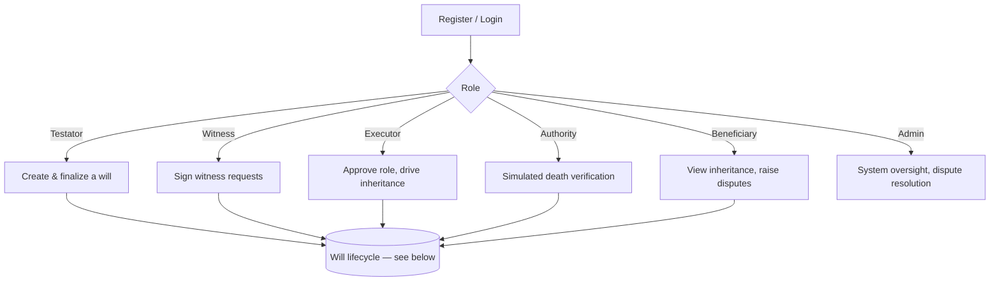
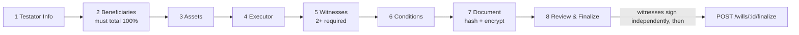
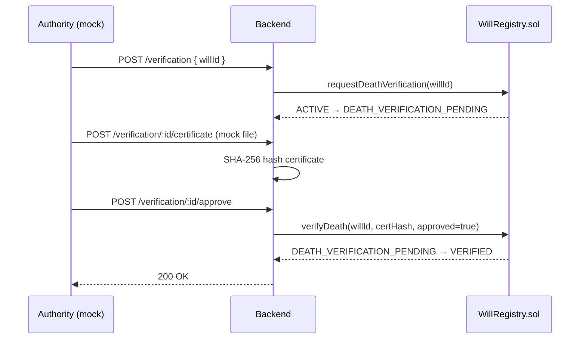

# Project Flow

## Overall user workflow



## Will creation workflow (8-step wizard)



Each step commits to the database and, for on-chain-relevant data, to the blockchain immediately — there is no separate "save draft" step, because the draft *is* saved (and partially on-chain) from step 1 onward.

## Death verification workflow (ACADEMIC SIMULATION)



## Inheritance execution workflow

```mermaid
flowchart TD
    V[VERIFIED] --> EA[Executor approves role<br/>ExecutorManager.executorApprove]
    EA --> SI[Executor starts inheritance<br/>InheritanceManager.startInheritance]
    SI --> IIP[INHERITANCE_IN_PROGRESS]
    IIP --> VB[Executor verifies each beneficiary<br/>verifyBeneficiary]
    VB --> EX[Executor executes<br/>executeInheritance]
    EX --> Elig{All beneficiaries<br/>currently eligible?}
    Elig -->|Yes| DONE[EXECUTED]
    Elig -->|No — e.g. time-locked| PART[Partial distribution;<br/>remaining beneficiaries call claim() later]
    PART --> Claim[claim() once condition met]
    Claim --> DONE
```

## Blockchain transaction lifecycle

See `docs/blockchain.md` "Transaction lifecycle" for the sequence diagram of how a single API call becomes a signed, mined, and persisted transaction.

## Status reference

`DRAFT → ACTIVE → DEATH_VERIFICATION_PENDING → VERIFIED → INHERITANCE_IN_PROGRESS → EXECUTED`, with `REVOKED` reachable from `DRAFT`/`ACTIVE`, and `DISPUTED` reachable from `ACTIVE`/`INHERITANCE_IN_PROGRESS` (returning to `INHERITANCE_IN_PROGRESS` if resolved). Full state machine in `docs/smart-contracts.md`.
