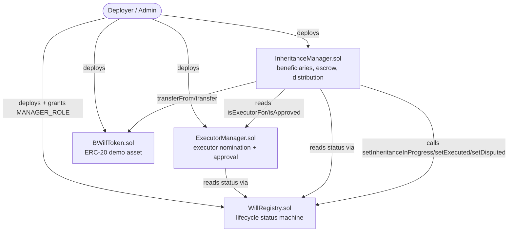
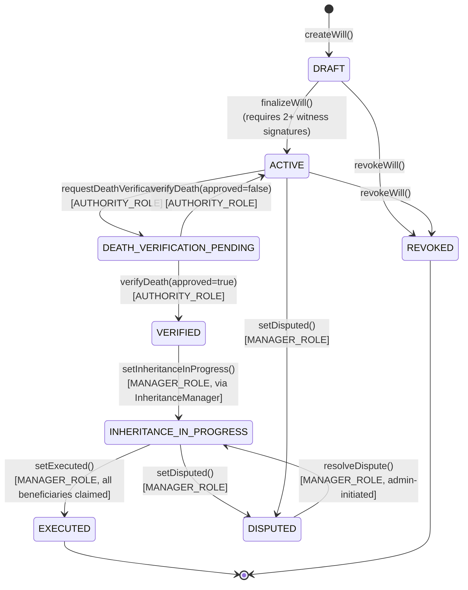

# Smart Contracts

Solidity `^0.8.24`, compiled and tested with Hardhat, built on OpenZeppelin `5.x` (`AccessControl`, `ReentrancyGuard`, `Pausable`, `SafeERC20`).

## Contract architecture

## WillRegistry.sol

Source of truth for a will's lifecycle. Stores only a content hash, creator, witness signatures, status, and timestamps — never the document itself.

**Status machine:**

Key functions: `createWill`, `addWitness`, `signAsWitness`, `updateDocumentHash`, `finalizeWill`, `revokeWill`, `requestDeathVerification`, `verifyDeath`, plus `setInheritanceInProgress`/`setExecuted`/`setDisputed`/`resolveDispute` gated to `MANAGER_ROLE` (granted only to the `InheritanceManager` and `ExecutorManager` contract addresses at deploy time).

Access control: `DEFAULT_ADMIN_ROLE` (deployer), `AUTHORITY_ROLE` (mock death-verification authority — granted to the demo authority account and to any user who registers with the `AUTHORITY` role), `MANAGER_ROLE` (the two dependent contracts).

## InheritanceManager.sol

Holds the beneficiary allocation table and inheritance conditions per will, escrows the demo `BWILL` token on the testator's behalf, and performs distribution.

- **Allocation** is stored in basis points (`10000` = 100%); `addBeneficiary` reverts if the running total would exceed 100%.
- **Conditions**: `IMMEDIATE`, `AGE_BASED` (eligible once `block.timestamp >= conditionParam`, a precomputed 18th-birthday timestamp), `TIME_LOCK` (eligible once `block.timestamp >= conditionParam`), `EXECUTOR_APPROVAL` (eligible once the executor has approved via `ExecutorManager`).
- **Escrow**: `depositAssets` pulls `BWILL` from the testator via `SafeERC20.safeTransferFrom` into the contract; `totalDeposited` is tracked separately from the mutable `escrowBalance` so proportional payouts are computed against the original deposit, not whatever happens to remain after partial claims.
- **Distribution**: `executeInheritance` loops over beneficiaries and pushes tokens to every currently-eligible one; anyone whose condition isn't met yet (e.g. still time-locked) is skipped and can later call `claim()` themselves (pull payment) once eligible. A beneficiary's `claimed` flag is set the moment they're paid and is checked before every payout — **this is what prevents double distribution**, both within a single `executeInheritance` call and across any number of later calls or `claim()` attempts.
- **Disputes**: any address that is a registered beneficiary on the will can call `raiseDispute`, which flips a local `disputed` flag and calls `WillRegistry.setDisputed`. Every payout path (`executeInheritance`, `claim`) is guarded by `notDisputed`, so a dispute immediately and unconditionally halts further distribution — it cannot be raced or bypassed. Only `DEFAULT_ADMIN_ROLE` can resolve a dispute.

## ExecutorManager.sol

Tracks who is nominated as executor per will and records their on-chain approval. `executorApprove` requires the will to already be `VERIFIED` — an executor cannot pre-approve before death has actually been confirmed. `InheritanceManager.executeInheritance` requires `ExecutorManager.isApproved(willId)` to be true, so distribution is impossible without this explicit, separately-signed step.

## BWillToken.sol

A minimal ERC-20 (`ERC20` + `AccessControl`, `MINTER_ROLE` restricted) used purely to make on-chain inheritance distribution visibly demonstrable — 5,000 BWILL split 50/30/20 between three beneficiaries is easy to verify by eye and by balance query. It is explicitly a demo asset, not a real currency.

## Security patterns used

| Pattern | Where | Why |
|---|---|---|
| `AccessControl` roles | All four contracts | Fine-grained, revocable permissions instead of a single owner |
| `ReentrancyGuard` | `InheritanceManager` (deposit/withdraw/execute/claim) | These are the only functions that move value |
| Checks-effects-interactions | `executeInheritance`, `claim` | State (`claimed`, `escrowBalance`) is updated before the external `safeTransfer` call |
| `SafeERC20` | All token transfers | Reverts on non-standard ERC-20 return-value behavior |
| Custom errors | Everywhere | Cheaper than `require(string)` and self-documenting |
| Idempotent status guards | Every state-changing function | Every transition checks the *current* status before acting — an out-of-order or duplicate call reverts instead of corrupting state |
| Pull-payment fallback | `claim()` | Guarantees a beneficiary can always eventually receive funds once eligible, even if a push in `executeInheritance` was skipped |

## Testing

`contracts/test/*.test.ts` — 20 tests covering: will creation/duplication, witness signature minimums, revocation authorization and timing, access-control on every role-gated function, full lifecycle happy path, executor-approval gating, time-lock conditions, dispute pause/resolve, and escrow refund on revocation. See `docs/testing.md`.
